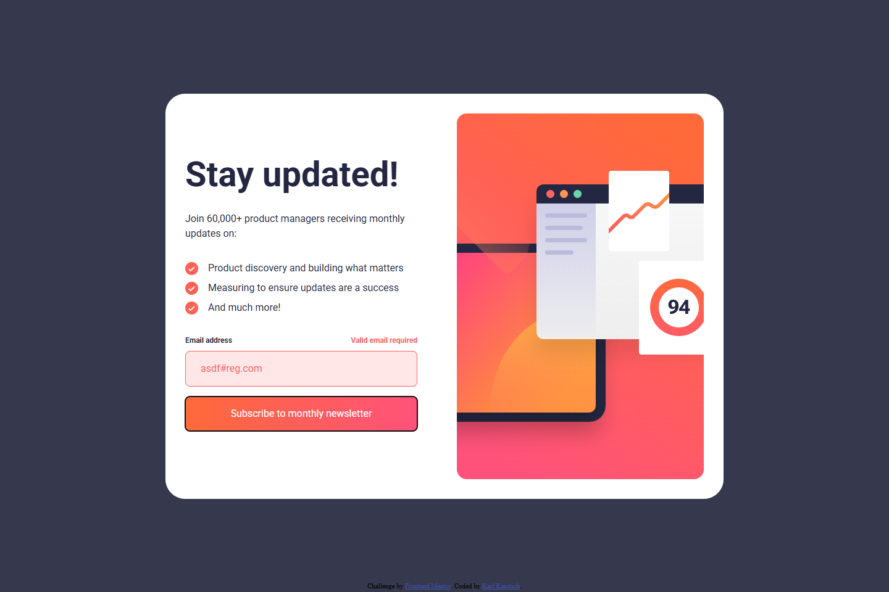
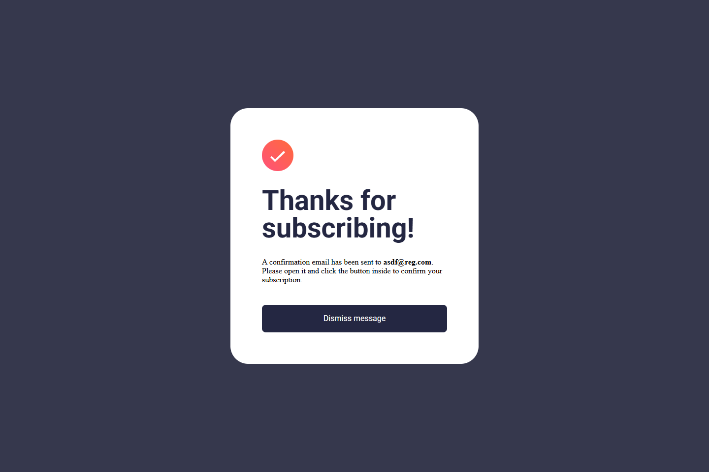
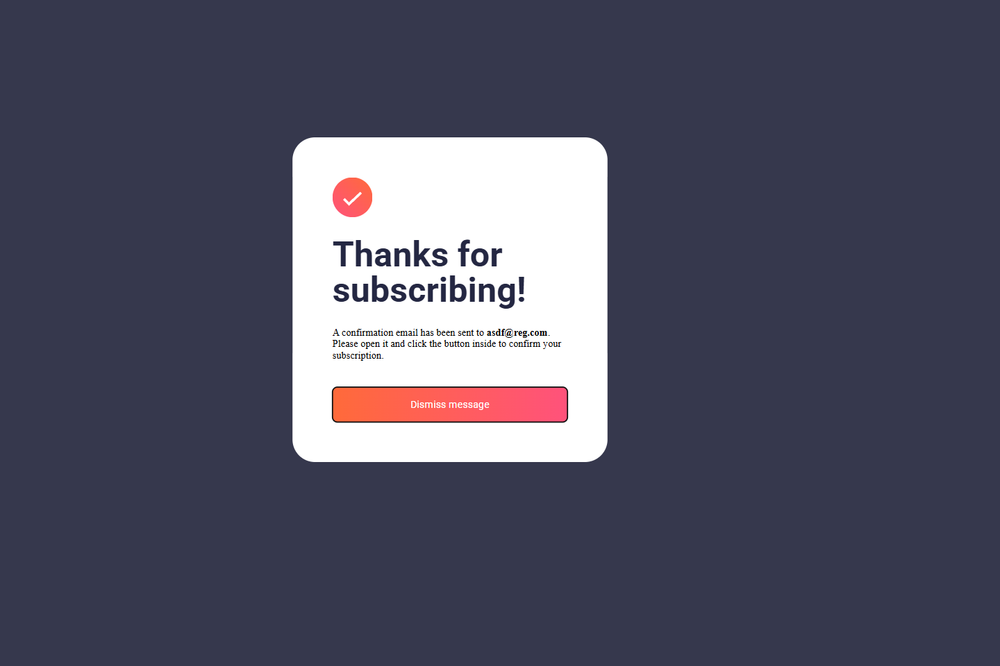
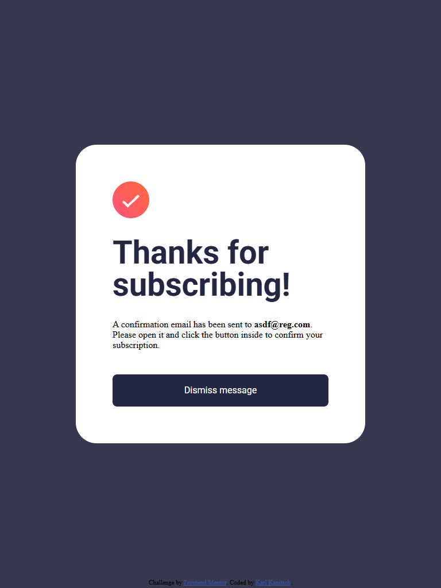
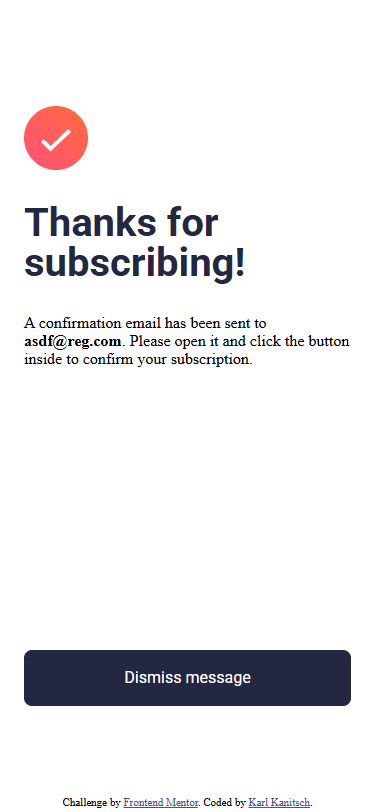

# Frontend Mentor - Newsletter sign-up form with success message solution

This is a solution to the [Newsletter sign-up form with success message challenge on Frontend Mentor](https://www.frontendmentor.io/challenges/newsletter-signup-form-with-success-message-3FC1AZbNrv). Frontend Mentor challenges help you improve your coding skills by building realistic projects. 

## Table of contents

- [Frontend Mentor - Newsletter sign-up form with success message solution](#frontend-mentor---newsletter-sign-up-form-with-success-message-solution)
	- [Table of contents](#table-of-contents)
	- [Overview](#overview)
		- [The challenge](#the-challenge)
		- [Screenshot](#screenshot)
		- [Links](#links)
	- [My process](#my-process)
		- [Built with](#built-with)
		- [What I learned](#what-i-learned)
		- [Continued Development](#continued-development)
		- [Useful resources](#useful-resources)
	- [Author](#author)

## Overview
This challenge involved creating a responsive page with a simple newsletter sign-up form. The layout included a few familiar challenges, such as rearranging the image and article components.

The main new aspect was styling the form interactively based on focus, hover, and invalid entries. We also needed to update the page content after a successful submission, using client-side validation.


### The challenge

Users should be able to:

- Add their email and submit the form
- See a success message with their email after successfully submitting the form
- See form validation messages if:
  - The field is left empty
  - The email address is not formatted correctly
- View the optimal layout for the interface depending on their device's screen size
- See hover and focus states for all interactive elements on the page

### Screenshot

- Desktop View 
- Desktop View with form active 
- Desktop View with e-mail input error 
- Desktop View with success page 
- Desktop View with success page and active button 
- Tablet View  
  
- Tablet View with form active
  
- Tablet View with e-mail input error
  
- Tablet View with success page
  
- Mobile View  
  
- Mobile View with form active  
  
- Mobile View with e-mail input error  
  
- Mobile View with success page  
  

### Links

- Solution URL: [https://github.com/kkanit22/FEM-3-2-newsletter-signup-form](https://github.com/kkanit22/FEM-3-2-newsletter-signup-form)
- Live Site URL: [https://kkanit22.github.io/FEM-3-2-newsletter-signup-form/](https://kkanit22.github.io/FEM-3-2-newsletter-signup-form/)

## My process

### Built with

- Semantic HTML5 markup
- CSS custom properties
- Flexbox
- Mobile-first workflow

### What I learned

The layout challenges here were mostly repeats of what we have already seen, but the JavaScript was a little more invovled for this challenge. We again had to manage the visibility state of components, but we also needed to get data from a form. I used the FormData interface to convert the form entries into a simple object that made the data easy to read.

```js
const form = document.getElementById('newsletter-signup-form');
const formData = new FormData(e.target);
const data = Object.fromEntries(formData);
```

This would result in a data object of the form: 
```js
data = {email: 'asdf@reg.com'};
```

We also needed to validate the format of an e-mail address. I learned to do this using a regex expression to set the format requirements and testing it with a ```string.match()``` method. This also gave me a chance to review my understanding of regex.

```js
const emailRegex = /^[^\s@]+@[^\s@]+\.[^\s@]+$/;
emailRegex.test(data.email) ? showSuccess(data.email) : showFailure();
```

I also want to call out another JavaScript DOM property I found particularly helpful for this challenge: ```element.innerHTML```. I wanted to have the success page parrot the entered e-mail address from the form, but to do this I had to update the contents of the paragraph element. Initial searches suggested using ```element.textContent```, but this did not work for me. A little more investigation revealed that that is only useful if you are updating plain text, but since the e-mail address was surrounded by a ```<strong>``` tag, I needed to use ```innerHTML```.

```js
const successText = document.getElementById('success-text');
successText.innerHTML = 'text <strong>' + emailAddress + '</strong> text';
```

**Additions added after the submitted code was reviewed:**  
I was reminded of the dangers of innerHTML and as suggested have adapted my solution to only change the `textContent` of the inner `<strong>` element to completely avoid innerHTML dangers. I have also left a no longer needed `escapeHtml(str)` function in the javascript so that I can refer back to it the next time I need to use `innerHTML` and have to escape it first.

I have also learned a little more about how screen readers detect page updates. In particular, when I change the page from the sign-up form to the success page, adding `role="status"` should cause the screenreader to announce the change. I have also added this to the main element in case switching back to that would also not have been announced.

### Continued Development  
I plan to spend more time learning about parsing and validating data from forms. In particular I worry that my solution does not sanitize the e-mail address to ensure there is no SQL injection or XML. While proper use of modern Java database packages provide protection, I may not always be working on the back-end or even know much about the language.

### Useful resources

- [RegExr](https://regexr.com/) - While this site was down for maintenance, I am hoping it will be back up soon as this is my main resource for help with regex. You can type and test your own regex in it, or paste copied regex expressions and get a full syntactical breakdown of what it would match.
- [Quick-Start: Regex Cheat Sheet](https://www.rexegg.com/regex-quickstart.php#ref) - This is the regex reference I used since RegExr is down and found it has some advantages of its own. In particular I like that it specifies how different regex implementations are likely to implement each symbol.

## Author

- Frontend Mentor - [@kkanit22](https://www.frontendmentor.io/profile/kkanit22)